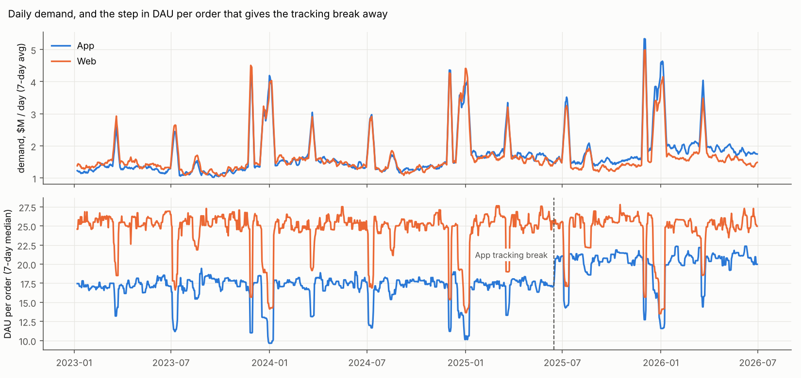
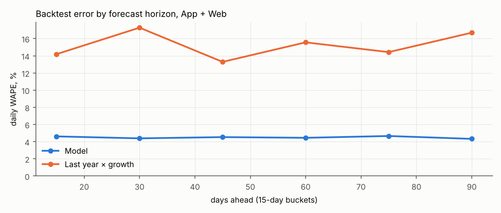
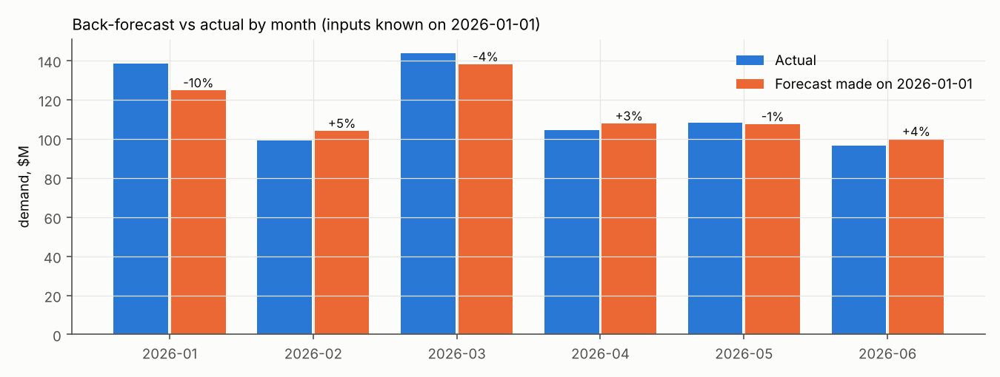

# demandcast

**Leakage-safe e-commerce demand forecasting: traffic × conversion × order value, with paid-media effects.**

Daily demand is split into the three things that drive it: how many people show up (DAU), how many of them buy
(CVR), and how much they spend (AOV). Each piece gets its own regression, so a forecast miss can be traced to the
piece that caused it. Paid search and social enter as adstocked elasticities, and every number is evaluated
without the model seeing the days it forecasts.

All data in this repo is **synthetic** (`demandcast.make_dataset()`), generated with known true effects so the
model can be checked against the truth.



## What it does

| Piece | Model |
|---|---|
| Traffic | `log(DAU)` ~ trend + weekday + yearly Fourier terms + sale events + tracking period + paid media |
| Conversion | `logit(CVR)` ~ the same + share of orders on promotion |
| Order value | `log(AOV)` ~ trend + seasonality + events + discount depth |
| Forecast | orders = DAU × CVR, demand = orders × AOV |

- **Paid media as elasticities.** Spend enters as `log(adstocked spend / training median)`, so a coefficient is
  the % change in traffic per 1% more spend. Carry-over (adstock) flows from history into the forecast.
- **Only defensible spend effects are kept.** HAC standard errors (daily errors are autocorrelated), a minimum
  |t|, and sign rules: spend can't reduce traffic, and paid traffic can't convert better than organic.
  Effects that fail are dropped and the regression is refitted.
- **Tracking breaks are found, not assumed.** A step in log(DAU / orders) means the counting changed, not the
  customers. Breaks are detected on the training days only and become a tracking-period term.
- **Leakage-safe evaluation.** Everything learned from data (coefficients, spend reference levels, tracking
  breaks) is learned before the forecast date. Tests enforce it.

## Results on the synthetic data

**Spend effects recovered** (DAU elasticity, 95% interval from HAC standard errors):

| Channel | Media | True | Estimated | 95% interval | Without event controls |
|---|---|---|---|---|---|
| App | search | 0.05 | 0.061 | 0.049 to 0.074 | 0.139 |
| App | social | 0.07 | 0.052 | 0.040 to 0.064 | 0.089 |
| Web | search | 0.08 | 0.081 | 0.067 to 0.094 | 0.158 |
| Web | social | 0.04 | 0.052 | 0.039 to 0.066 | 0.088 |

Spend is higher during sale events, as it usually is. Without event controls the model credits spend for the
event lift and roughly doubles the estimate. With them, estimates land within 0.02 of the truth; App social is
underestimated because search and social share a Q4 ramp that seasonality also explains.

**Rolling-origin backtest** (21 monthly origins, 90 days ahead each, trained on earlier days only):

| | 30-day WAPE | Bias |
|---|---|---|
| Model | 1.3% | +0.5% |
| Same weekday last year × growth | 8.1% | −0.3% |



**Back-forecast** made on 2026-01-01 with only what was known that day (promos and spend copied from last year):
misses of −10% to +5% by month. With the inputs that actually ran, −4% to +3%. The gap is the cost of not knowing
the plan, not of the model.



> Synthetic data follows the model's own structure, so the accuracy here is optimistic. The point of the repo is
> the method: decomposed demand, defensible spend effects, and evaluation that can't cheat.

## Quick start

```bash
pip install -e ".[dev]"
pytest                                  # 10 tests, ~5 s
python scripts/build_demo.py            # rebuilds notebooks/demo.ipynb and the charts in docs/
```

```python
from demandcast import make_dataset, DemandModel, rolling_backtest, summarize_backtest, back_forecast

daily, spend, truth = make_dataset()
model = DemandModel().fit(daily[daily.date < "2026-01-01"])
model.spend_effects()                   # elasticities, t-values, kept / dropped
model.breaks()                          # tracking breaks found per channel

bt = rolling_backtest(daily, origins=["2025-07-01", "2025-10-01"], horizon=90)
summarize_backtest(bt)

back_forecast(daily, as_of="2026-01-01", period_end="2026-06-30", promo="last_year", spend="last_year")
```

## Repo layout

```
src/demandcast/
  synth.py      synthetic data with known truth (events, promos, adstocked spend, a tracking break)
  features.py   event calendar, Fourier seasonality, adstock, tracking-break detection, spend terms
  model.py      DemandModel: DAU / CVR / AOV regressions, spend-effect rules, spend_response()
  evaluate.py   WAPE, bias, seasonal-naive benchmark, rolling backtest, back-forecast
tests/          leakage, elasticity recovery, break detection, benchmark comparison
notebooks/      demo.ipynb (runs end to end on synthetic data)
```

## Tests worth reading

- `test_back_forecast_does_not_see_later_actuals`: multiplies every outcome and input after the forecast date and
  checks the forecast doesn't move.
- `test_backtest_trains_before_each_origin`: spies on `fit()` to confirm each refit only sees earlier days.
- `test_recovers_spend_elasticities` and `test_event_controls_matter`: the model finds the true effects, and
  fails in the expected way without the controls.

## Limits and next steps

- Observational spend effects are correlational. A geo or holdout lift test is the way to calibrate them.
- Spend is assumed to act through log adstock with a fixed decay; decay could be tuned in the backtest.
- No saturation curve beyond the log; very large budget changes would need one.

## License

MIT
